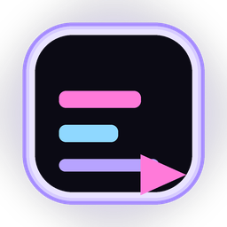
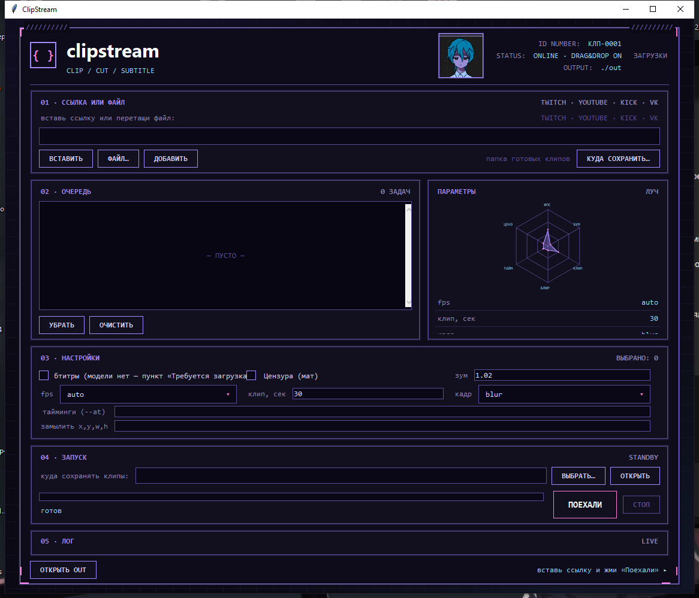
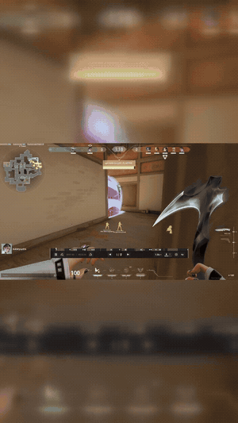

# ClipStream — вертикальные клипы из стримов

**Ссылка на Twitch, YouTube, Kick или VK (или локальный файл) → готовый вертикальный клип 1080×1920 с прожжёнными субтитрами.**
Бесплатно, без лимитов и водяных знаков. Всё работает на вашем компьютере: ни сервисов, ни интернета после установки.

[**⬇ Скачать ClipStream 1.1.1 для Windows**](https://github.com/eisaqsa/clipstream/releases/latest) · [Как установить](#установка-обычный-пользователь) · [FAQ](FAQ.md) · [Сообщить об ошибке](https://github.com/eisaqsa/clipstream/issues/new/choose)

**Free to use · Closed Source.** ClipStream бесплатен для всех функций, но
исходный код будущих версий закрыт. Подробнее — в разделе [«Лицензия»](#лицензия).

## Что умеет

- **Из ссылки или файла.** Twitch, YouTube, Kick, VK — или локальная запись.
- **Вертикаль 1080×1920** с прожжёнными субтитрами: текущее слово подсвечивается, текст не вылезает за края.
- **Автонарезка** по громкости и словам («клатч», «эйс», «вайп», смех) либо точные таймкоды `--at`.
- **Чистый кадр:** размытый фон или кроп, зум, авто- и ручное замыливание рекламы, цензура мата.
- **Звук как в ленте:** −14 LUFS, плавное появление и затухание.
- **Всё локально:** бесплатно, без лимитов, без водяных знаков.

> Частота кадров клипа = частоте записи: 120-герцовый DVR даёт 120 fps, 60-герцовый — 60. Можно задать вручную: `--fps 30`.

## Пример результата

Клип, собранный ClipStream из записи стрима (1080×1920, субтитры прожжены в кадр):

## Установка (обычный пользователь)

Скачайте один файл **`ClipStream-Setup-1.1.1.exe`** (~62 МБ) со страницы [Releases](https://github.com/eisaqsa/clipstream/releases/latest). Права администратора не нужны.

1. Запустить установщик, дождаться ярлыка **ClipStream** на рабочем столе.
2. Первый запуск: ClipStream сам проверит компоненты и покажет, что нужно скачать
   (FFmpeg 86 МБ, yt-dlp 22 МБ, модель субтитров 486 МБ). Загрузка с прогрессом,
   докачкой и проверкой SHA-256; скачанное сохраняется, при обрыве не пропадает.
3. Дальше программа запускается сразу: повторно ничего не качается, только
   отсутствующее или повреждённое.

Без интернета на первом запуске: ClipStream скажет, чего не хватает, и предложит
**продолжить без субтитров**. Монтаж из локального файла заработает, как только
будет скачан FFmpeg.

## Исходный код

Исходный код ClipStream закрыт. Публикуются только готовые установщики и
пользовательская документация — поэтому в этом репозитории нет `.py`-файлов
и скриптов сборки. Программа от этого не становится платной: все функции
доступны бесплатно (см. [«Лицензия»](#лицензия)).

## Где хранятся файлы

Программа (только чтение) и данные разделены:

| Что | Где |
|---|---|
| Программа после установки | `%LOCALAPPDATA%\Programs\ClipStream` |
| Настройки, скачанные компоненты, клипы | `%LOCALAPPDATA%\ClipStream` |
| `bin\` (ffmpeg, ffprobe, yt-dlp) | `%LOCALAPPDATA%\ClipStream\bin` |
| Модели распознавания | `%LOCALAPPDATA%\ClipStream\models\<имя>` |
| `settings.json`, `out\`, `in\`, `tmp\` | `%LOCALAPPDATA%\ClipStream` |

Старая раскладка (`bin\` рядом с exe) тоже поддерживается: в этом случае папкой
данных считается папка программы. При переезде старый `settings.json`
**копируется** в новую папку, ничего не удаляется.

Состояние компонентов и контрольные суммы — в `manifest.json`. Его можно
обновить, не пересобирая exe: положить новый `manifest.json` в папку данных.

## Что в репозитории

- `README.md` — описание программы и инструкции
- `FAQ.md` — частые вопросы и типичные ошибки
- `RELEASE_NOTES.md` — что менялось в каждом релизе
- `CHANGELOG.md` — краткая история версий
- `LICENSE` — проприетарная лицензия ClipStream
- `EULA.txt` — пользовательское соглашение
- `LICENSE-MIT-1.1.0.txt` — лицензия MIT для версий 1.1.0 и ранее
- `THIRD_PARTY_LICENSES.md` — лицензии сторонних компонентов
- `assets\` — логотип, иконка и скриншоты для документации

## Окно программы

Окно тянется за любой край и угол: интерфейс подстраивается вместе с ним (шрифты, отступы,
«луч»), прокрутки нет. Минимальный размер — 760×690.
Перетаскивание окна по экрану ничего не пересчитывает — не тормозит и не дёргается.

Куда сохранять готовые клипы задаётся в блоке «04 · ЗАПУСК»: кнопка
**КУДА СОХРАНИТЬ…** в панели со ссылкой или **ВЫБРАТЬ…** рядом с полем
«куда сохранять клипы». Путь запоминается в `settings.json`, рядом кнопка
**ОТКРЫТЬ** — открывает эту папку. Пустой путь = папка
`%LOCALAPPDATA%\ClipStream\out`.

В шапке окна — **ЗАГРУЗКИ**: состояние FFmpeg, yt-dlp и модели, докачка
недостающего и обновление yt-dlp одним кликом.

## Запуск без окна

У установленной программы есть консольный режим — те же возможности, что и в окне:

    "%LOCALAPPDATA%\Programs\ClipStream\ClipStream.exe" --clip "ССЫЛКА" --find

Если видео уже лежит в папке `in` (`%LOCALAPPDATA%\ClipStream\in`) и оно там
самое свежее — ссылку можно не указывать.

Режим «я сам знаю таймкоды» (для Valorant — так точнее):

    "%LOCALAPPDATA%\Programs\ClipStream\ClipStream.exe" --clip "ССЫЛКА" --at 12:34 15:02 41:10

Диапазон, если момент длиннее стандартных 30 секунд:

    "%LOCALAPPDATA%\Programs\ClipStream\ClipStream.exe" --clip "ССЫЛКА" --at 12:34-13:05

Локальный файл вместо ссылки:

    "%LOCALAPPDATA%\Programs\ClipStream\ClipStream.exe" --clip "D:\video.mp4" --find

Полезное:

- `--count 5` — сколько клипов искать (по умолчанию 3)
- `--len 20` — длина клипа, сек (по умолчанию 30)
- `--fit blur` — весь кадр целиком на размытом фоне (по умолчанию). `--fit crop` — кадр заполнен, бока срезаны
- `--zoom 1.02` — приблизить геймплей. Зум режет только бока, верх и низ кадра остаются целиком
- `--auto-blur` — сам находит статичные баннеры (реклама, рамки) и замыливает их
- `--blur 120,40,360,400` — замылить конкретный прямоугольник в исходном кадре, можно повторять
- `--model base` — быстрее, но субтитры грубее (`small` по умолчанию, `medium` точнее и медленнее)
- `--fps auto` — частота готового клипа. По умолчанию как в записи; можно `--fps 30` / `60` / `120`
- `--censor` — мат в субтитрах закрывается звёздочками, а в звуке глушится
- `--no-smart` — при автонарезке учитывать только громкость, без слов (клатч/эйс/мат/смех)
- `--fast` — качать не весь VOD, а только нужный кусок. Twitch иногда отдаёт кусок со сдвигом 10–20 с
- `--no-subs` — без субтитров
- `--name q1ng` — префикс имени файлов в `out\`
- `--out "D:\клипы"` — куда класть готовые клипы (по умолчанию `%LOCALAPPDATA%\ClipStream\out`)

## Реклама на стриме

`--auto-blur` сам вырезает статичные надписи: скрипт смотрит первые 60 секунд,
считает, какие пиксели не меняются, и замыливает прямоугольники. Живой геймплей
не трогает, потому что он двигается.

Анимированные баннеры (бегущая строка, меняющийся текст) автопоиск не увидит —
он находит только неподвижные картинки. Их задают руками:

    --blur 1640,900,240,160 --blur 120,430,360,100

Координаты в пикселях исходного видео, `x,y,ширина,высота`, флаг можно повторять.
Найти их можно так: открыть кадр записи в просмотрщике
(`bin\ffmpeg.exe -ss 20 -i видео.mp4 -frames:v 1 кадр.png`) и посмотреть значения.

## Субтитры

Пишутся только там, где реально есть речь. Если в записи нет микрофона или
только выстрелы и музыка — скрипт печатает «речи почти нет» и рендерит клип
без субтитров: выдуманные субтитры не жгутся.

Строка — до 20 символов, до 4 слов, шрифт 80. Текущее слово подсвечивается
жёлтым, при появлении новой строки текст слегка «выпрыгивает». Длинная фраза
переносится на вторую строку, за края кадра не вылезает.

Звук приводится к −14 LUFS с плавным появлением и затуханием — громкость клипа
совпадает с остальными видео в ленте.

## Автонарезка

По умолчанию момент выбирается по громкости плюс бонус за слова: «клатч»,
«эйс», «вайп», «хедшот», «изи», смех и мат. Границы клипа сдвигаются к краям
фраз, чтобы не обрезать слово. Отключить учёт слов — `--no-smart`.

На ровном игровом звуке без речи автонарезка угадывает плохо: лучше резать
руками через `--at`.

## Сколько ждать

- Первый запуск: FFmpeg 86 МБ (~20 с на 4–5 МБ/с), yt-dlp 22 МБ, модель `small`
  486 МБ. Повторные запуски — без загрузки.
- Рендер клипа 30 сек (1080p, blur+zoom): ~13 сек в 60 fps, ~21 сек в 120 fps.
- Распознавание речи: модель грузится с диска, разбор — примерно 1 минута
  на 5 минут видео.

## Если сломалось

Коротко — ниже, подробно и с остальными ошибками — в [FAQ.md](FAQ.md).

- `ffmpeg не найден` / `yt-dlp не найден` — нажмите **ЗАГРУЗКИ** в шапке окна и
  докачайте компоненты; обновить yt-dlp: **ЗАГРУЗКИ** → «Проверить обновление
  yt-dlp».
- Первый запуск без интернета — ClipStream предложит продолжить без субтитров;
  докачать позже можно кнопкой **ЗАГРУЗКИ**.
- «Файл повреждён (не сошлась контрольная сумма)» — битый файл удаляется и
  качается заново автоматически, просто повторите загрузку.
- Субтитров нет — в записи нет речи (см. раздел «Субтитры»).

## Обратная связь

- Нашли ошибку или есть идея — [Issues](https://github.com/eisaqsa/clipstream/issues/new/choose).
- Вопрос, опыт, готовые настройки — [Discussions](https://github.com/eisaqsa/clipstream/discussions).
- Частые вопросы и типичные ошибки — [FAQ.md](FAQ.md).

## Лицензия

**ClipStream — Free to use · Closed Source.** Программа бесплатна целиком:
все функции доступны без подписки, оплаты и лицензионных ключей. Исходный
код будущих версий закрыт. Готовые клипы, которые вы сделали, — ваши: их
можно свободно публиковать, распространять и монетизировать, в том числе
на платных платформах.

Программа лицензируется, а не продаётся. Без письменного разрешения
правообладателя нельзя перепродавать ClipStream, распространять установщики
и изменённые сборки, переименовывать программу или выдавать её и её исходный
код за собственную разработку. Подробности — в [LICENSE](LICENSE) и
[EULA.txt](EULA.txt).

Версии 1.1.0 и более ранние распространялись по лицензии MIT. Эти права
не отменяются: текст сохранён в
[LICENSE-MIT-1.1.0.txt](LICENSE-MIT-1.1.0.txt). Проприетарные условия
действуют начиная с 1.1.1.

Лицензии сторонних компонентов (FFmpeg, yt-dlp, модель Whisper) — в
[THIRD_PARTY_LICENSES.md](THIRD_PARTY_LICENSES.md). Они не входят в
лицензию ClipStream и не ограничиваются ею.
